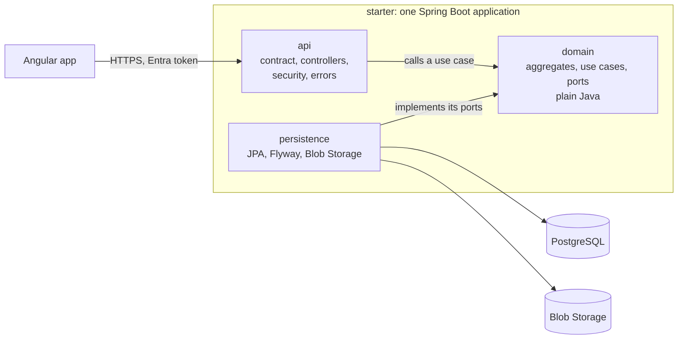
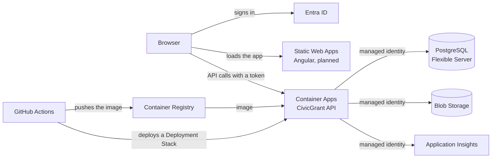

# CivicGrant

A grant application portal for a (fictional) Belgian public administration. Non-profit organisations apply for funding through a call for projects, a civil servant assesses each application, and a separate decision maker approves or rejects it with a written motivation.

I built this to get hands-on with Azure on a project that looks like the applications I work on day to day: a real workflow, real rules, two languages, and more than one kind of user.

## How it works

A programme manager opens a funding call, for example "Neighbourhood Projects 2026", with a budget of 50,000 euros, a maximum of 15,000 euros per application and a closing date.

1. An organisation creates an application in Dutch or French, attaches a PDF and submits it before the deadline.
2. A civil servant checks eligibility, writes an assessment and proposes an amount.
3. A decision maker approves or rejects. Every approval is taken from the call's budget.
4. The applicant follows the status of their application and sees the outcome with its motivation.

Applications are evaluated one by one as they come in (rolling evaluation). Good projects are funded until the budget runs out. [ADR 1](docs/adr/0001-rolling-evaluation.md) explains why it isn't a competitive ranking.

### Roles

| Role | Can do |
|---|---|
| Applicant | Create, edit and submit their own applications, upload documents, follow progress |
| Assessor | See submitted applications, record an assessment |
| Decision maker | Approve or reject assessed applications |
| Programme manager | Open funding calls, with their dates and budget |

Everyone signs in with Microsoft Entra ID, which is the only user store. CivicGrant keeps no accounts and no passwords, only each user's Entra object id next to the data they own, so there's no registration step. Staff get an account in the administration's tenant and a role from an administrator, which is how workforce applications usually work, and a user without a role gets no token at all. Applicants are a deliberate simplification: here they're users of the same tenant, given the Applicant role by an administrator. A real portal would let citizens sign in on their own, through the Federal Authentication Service (eID, itsme) or a Microsoft Entra External ID tenant with self-service sign-up, where every signed-in citizen is an applicant and only staff need a role.

## Business rules

- A funding call has a unique reference of capitals, digits and hyphens. It closes after it opens and can't be opened once its closing date has passed. Its cap per application is above zero and at most its total budget.
- The enterprise number (KBO/BCE) must be valid, including its mod-97 checksum.
- Only non-profits can apply: associations (vzw/asbl), international associations (ivzw/aisbl) and foundations.
- An application can't be submitted after the call has closed.
- The requested amount can't exceed the call's per-application cap, or the total cost of the project.
- An application needs at least one supporting document, a PDF of at most 10 MB, before it can be submitted.
- Applicants only see their own applications.
- Status changes follow a fixed path: `DRAFT -> SUBMITTED -> ASSESSED -> APPROVED | REJECTED`.
- The person who assessed an application can't also decide on it, and applicants can't assess or decide on their own application.
- The proposed and granted amounts can't exceed the requested amount, and an application assessed as ineligible can only be rejected.
- An approval can't exceed what is left of the call's budget, even when two decision makers approve at the same time.
- Every decision needs a motivation, and a rejection needs one of the formal grounds (ineligible, budget exhausted, incomplete, insufficient quality). Belgian administrative law requires public decisions to be motivated, so this isn't optional.
- Every relevant action is written to an audit trail.

The rules live in the domain model and are covered by unit tests named after the rule. The database repeats the most important ones as constraints, as a safety net.

## Architecture

Hexagonal architecture, split into four Maven modules so the dependency direction is enforced by the build and not just by convention.

```
civicgrant/
├── domain/        aggregates, business rules, use cases and ports. Plain Java.
├── api/           OpenAPI contract, generated interfaces, REST controllers
├── persistence/   JPA and PostgreSQL, Flyway migrations, Blob Storage
├── starter/       Spring Boot application, configuration and wiring
└── infra/         Bicep templates for the Azure infrastructure
```



`api` and `persistence` depend on `domain`, never on each other. `starter` puts everything together. The domain doesn't know about Spring, JPA or Azure, and ArchUnit tests check that it stays that way. They also check the hexagon's own conventions: the API reaches the domain only through use cases, persistence only through outbound ports, each use case is an interface with one method taking one command or query, each service implements exactly one use case, JPA stays inside persistence, outside the domain an aggregate is only ever read, and only persistence rebuilds one from storage.

The API is contract-first: `api/src/main/openapi/openapi.yaml` is written by hand and is the single source of truth. The Spring interfaces and the Angular client are generated from it, and the pipeline lints it with Redocly on every change. The application serves the API only, not its documentation.

**Backend:** Java 25, Spring Boot 4, Spring Security (OAuth2 resource server), Spring Data JPA, Flyway, PostgreSQL
**Frontend:** Angular with standalone components, signals, zoneless change detection, Dutch and French
**Testing:** JUnit, Testcontainers, ArchUnit, Playwright

### Where to look first

If you only have a few minutes, these files show how the pieces fit:

- [GrantApplication](domain/src/main/java/be/achzak/civicgrant/domain/grantapplication/model/GrantApplication.java): the aggregate. Every step of the workflow is a method named after it, and each one checks who acts, the status and the data, or throws.
- [ApproveApplicationService](domain/src/main/java/be/achzak/civicgrant/domain/grantapplication/service/ApproveApplicationService.java): a use case from start to end. It checks the role, changes two aggregates in one transaction so the budget can't be overspent, saves, then publishes the events.
- [ArchitectureTest](starter/src/test/java/be/achzak/civicgrant/ArchitectureTest.java): the conventions above as rules that fail the build, including that every use case checks the actor's role.
- [UseCaseTransactionAttributeSource](starter/src/main/java/be/achzak/civicgrant/starter/usecase/UseCaseTransactionAttributeSource.java): how a domain without annotations still runs in transactions. A command gets a read-write one, a query a read-only one.
- [GrantApplicationPersistenceAdapter](persistence/src/main/java/be/achzak/civicgrant/persistence/grantapplication/GrantApplicationPersistenceAdapter.java): optimistic locking that turns a lost race into a 409, and the paged search.
- [DomainProblemHandler](api/src/main/java/be/achzak/civicgrant/api/error/DomainProblemHandler.java): how domain exceptions become Belgif problems, in one exhaustive switch.
- [openapi.yaml](api/src/main/openapi/openapi.yaml): the contract the controllers implement.

## Azure

| Service | Used for |
|---|---|
| Container Registry | The application image, shared by all environments |
| Container Apps | Hosting the backend |
| Static Web Apps | Hosting the Angular frontend |
| Database for PostgreSQL (Flexible Server) | Application data |
| Blob Storage | Uploaded PDFs, in a private container |
| Entra ID | Staff authentication and app roles |
| Managed Identity | Passwordless access to PostgreSQL and Blob Storage |
| Key Vault | The few secrets that can't be avoided |
| Application Insights | Logs, metrics and request tracing |
| Azure Policy | Refusing any resource that breaks the project's security and region rules |
| Azure Monitor | An email alert on server errors and a monitoring workbook per environment |



All infrastructure is defined in Bicep. GitHub Actions builds one image per commit and promotes it through three environments:

| Trigger | Environment |
|---|---|
| Push to `develop` | Test |
| Push to `main` | Acceptance |
| Manual approval after acceptance | Production, with the same image |

The pipeline authenticates to Azure with workload identity federation, so there are no stored credentials anywhere, including in CI.

## Decisions

Every architectural decision is recorded in [docs/adr](docs/adr/README.md): the context that called for it, what was decided, the alternatives, and what it costs. There are 49, grouped by area. The ones that shape the code most:

- [Aggregates guard their own rules](docs/adr/0002-aggregates-guard-their-own-rules.md)
- [Roles are checked by the domain, and the build fails if a use case forgets](docs/adr/0005-roles-are-checked-by-the-domain.md)
- [Failures are codes, in four families](docs/adr/0010-failures-are-codes-in-four-families.md), which [become Belgif problems in the API, not in the domain](docs/adr/0011-domain-exceptions-become-belgif-problems-in-the-api.md)
- [The audit trail is built from domain events, and holds no free text](docs/adr/0012-audit-trail-from-domain-events.md)
- [The budget can't be overspent, even by two decision makers at once](docs/adr/0014-the-budget-cannot-be-overspent.md)
- [Each environment has two identities, each allowed one job](docs/adr/0035-two-identities-per-environment.md)
- [Azure refuses what breaks the project's rules, through Azure Policy](docs/adr/0036-azure-policy-guardrails.md)

## Running it locally

Requirements: JDK 25 and Docker.

```bash
./mvnw clean install
./mvnw -pl starter spring-boot:run -Dspring-boot.run.profiles=local
```

The `local` profile starts PostgreSQL and Azurite through `compose.yaml`, keeps their data between runs and loads demo data from `db/seed`. Tests don't use it: they run against a throwaway PostgreSQL and Azurite started by Testcontainers.

## Status

- [x] Database schema
- [x] Multi-module structure
- [x] Domain model and rules
- [x] OpenAPI contract and Belgif error responses
- [x] Applicant flow: funding calls, organisations, grant applications, supporting documents and submission
- [x] Assessment and decision flow
- [x] Funding calls opened by a programme manager
- [ ] Angular frontend
- [x] CI pipeline: formatting, tests, SonarQube analysis and image publishing
- [x] Branch protection and security scanning
- [x] Container image
- [x] Shared Azure infrastructure: registry, pipeline identity and PostgreSQL server
- [x] Test environment, deployed by the pipeline on every push to develop
- [x] Staff sign-in with Microsoft Entra ID: app registration, app roles and token validation
- [x] Azure Policy guardrails on every CivicGrant resource group
- [x] Observability: JSON logs with trace ids, business metrics, an alert on server errors and a monitoring workbook
- [ ] Acceptance and production

## Out of scope

Things a real system would need, left out to keep the project finishable:

- Citizen and organisation login through the Federal Authentication Service (eID, itsme), and verification that the applicant may represent the organisation.
- Private networking (VNet integration, private endpoints) and API Management.
- Payments of approved grants.
- Appeals against a decision.
- Notifications, by email or in the application. Applicants follow the status of their application in the portal.
