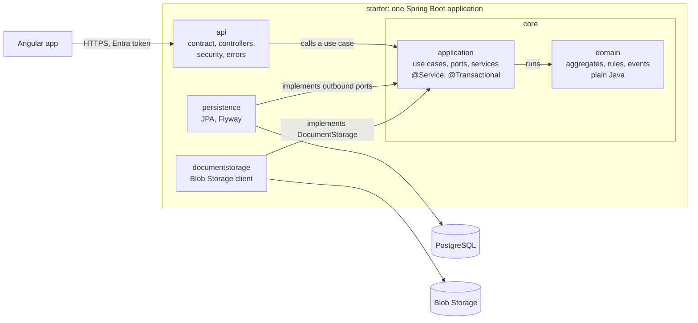
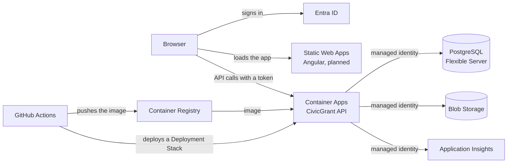

# CivicGrant

A grant application portal for a (fictional) Belgian public administration. Non-profit organisations apply for funding through a call for projects, a civil servant assesses each application, and a separate decision maker approves or rejects it with a written motivation.

I built this to get hands-on with Azure on a project that looks like the applications I work on day to day: a real workflow, real rules, two languages, and more than one kind of user.

## How it works

A programme manager opens a funding call, for example "Neighbourhood Projects 2026", with a budget of 50,000 euros, a maximum of 15,000 euros per application and a closing date.

1. An organisation creates an application in Dutch or French, attaches a PDF and submits it before the deadline.
2. A civil servant checks eligibility, writes an assessment and proposes an amount.
3. A decision maker approves or rejects. Every approval is taken from the call's budget.
4. The applicant follows the status of their application and sees the outcome with its motivation.

Applications are evaluated one by one as they come in (rolling evaluation). Good projects are funded until the budget runs out. It's a common model for smaller grants, and it keeps the project about the workflow: no scoring criteria, no ranking step, no bulk decisions.

### Roles

| Role | Can do |
|---|---|
| Applicant | Create, edit and submit their own applications, upload documents, follow progress |
| Assessor | See submitted applications, record an assessment |
| Decision maker | Approve or reject assessed applications |
| Programme manager | Open funding calls, with their dates and budget |

Everyone signs in with Microsoft Entra ID, which is the only user store. CivicGrant keeps no accounts and no passwords, only each user's Entra object id next to the data they own, so there's no registration step. Staff get an account in the administration's tenant and a role from an administrator, which is how workforce applications usually work, and a user without a role gets no token at all. Applicants are a deliberate simplification: here they're users of the same tenant, given the Applicant role by an administrator. A real portal would let citizens sign in on their own, through the Federal Authentication Service (eID, itsme) or a Microsoft Entra External ID tenant with self-service sign-up, where every signed-in citizen is an applicant and only staff need a role.

## Business rules

- A funding call has a unique reference of capitals, digits and hyphens. It closes after it opens and can't be opened once its closing date has passed. Its cap per application is above zero and at most its total budget.
- The enterprise number (KBO/BCE) must be valid, including its mod-97 checksum.
- Only non-profits can apply: associations (vzw/asbl), international associations (ivzw/aisbl) and foundations.
- An application can't be submitted after the call has closed.
- The requested amount can't exceed the call's per-application cap, or the total cost of the project.
- An application needs at least one supporting document, a PDF of at most 10 MB, before it can be submitted.
- Applicants only see their own applications.
- Status changes follow a fixed path: `DRAFT -> SUBMITTED -> ASSESSED -> APPROVED | REJECTED`.
- The person who assessed an application can't also decide on it, and applicants can't assess or decide on their own application.
- The proposed and granted amounts can't exceed the requested amount, and an application assessed as ineligible can only be rejected.
- An approval can't exceed what is left of the call's budget, even when two decision makers approve at the same time.
- Every decision needs a motivation, and a rejection needs one of the formal grounds (ineligible, budget exhausted, incomplete, insufficient quality). Belgian administrative law requires public decisions to be motivated, so this isn't optional.
- Every relevant action is written to an audit trail.

The rules live in the domain model and are covered by unit tests named after the rule. The database repeats the most important ones as constraints, as a safety net.

## Architecture

Hexagonal architecture, split into Maven modules so the dependency direction is enforced by the build and not just by convention: the core, one module per adapter, and the application that wires them.

```
civicgrant/
├── core/              the hexagon: a plain Java domain and an application layer per aggregate
├── api/               inbound adapter: OpenAPI contract, generated interfaces, REST controllers
├── persistence/       outbound adapter for PostgreSQL: JPA, Flyway migrations
├── documentstorage/   outbound adapter for Blob Storage: the supporting documents' files
├── starter/           Spring Boot application, configuration and wiring
└── infra/             Bicep templates for the Azure infrastructure
```



Each adapter depends on `core`, never on another adapter, and brings only its own technology: `persistence` has no Azure Storage client, `documentstorage` no JPA. `starter` puts everything together. Inside `core`, each aggregate has a domain layer (the aggregate, its rules and events) and an application layer (the use cases and outbound ports, and the services that run them), and the domain never depends on the application. The domain is plain Java, the application layer takes only `@Service` and `@Transactional` from Spring, and neither knows about JPA or Azure. ArchUnit tests check that it stays that way. They also check the hexagon's own conventions: the API reaches the core only through use cases, the outbound adapters only through outbound ports, adapters never use each other, outbound ports are interfaces, each use case is an interface with one method taking one command or query, each service implements exactly one use case and runs a command in a read-write transaction and a query in a read-only one, JPA stays inside persistence and the Blob Storage client inside documentstorage, outside the core an aggregate is only ever read, and only persistence rebuilds one from storage.

The API is contract-first: `api/src/main/openapi/openapi.yaml` is written by hand and is the single source of truth. The Spring interfaces and the Angular client are generated from it, and the pipeline lints it with Redocly on every change. The application serves the API only, not its documentation.

**Backend:** Java 25, Spring Boot 4, Spring Security (OAuth2 resource server), Spring Data JPA, Flyway, PostgreSQL, JSpecify with NullAway
**Frontend:** Angular with standalone components, signals, zoneless change detection, Dutch and French
**Testing:** JUnit, Testcontainers, ArchUnit, Playwright

### Where to look first

If you only have a few minutes, these files show how the pieces fit:

- [GrantApplication](core/src/main/java/be/achzak/civicgrant/core/grantapplication/domain/GrantApplication.java): the aggregate. Every step of the workflow is a method named after it, and each one checks who acts, the status and the data, or throws.
- [ApproveApplicationService](core/src/main/java/be/achzak/civicgrant/core/grantapplication/application/service/ApproveApplicationService.java): a use case from start to end. It checks the role, changes two aggregates in one transaction so the budget can't be overspent, saves, then publishes the events.
- [ArchitectureTest](starter/src/test/java/be/achzak/civicgrant/ArchitectureTest.java): the conventions above as rules that fail the build, including that every use case checks the actor's role.
- [GrantApplicationLifecycleTest](core/src/test/java/be/achzak/civicgrant/core/grantapplication/domain/GrantApplicationLifecycleTest.java): the workflow as one test. Every action is tried in every status: it moves the application on where the lifecycle allows it and is refused everywhere else.
- [GrantApplicationPersistenceAdapter](persistence/src/main/java/be/achzak/civicgrant/persistence/grantapplication/GrantApplicationPersistenceAdapter.java): optimistic locking that turns a lost race into a 409, and the paged search.
- [DomainProblemHandler](api/src/main/java/be/achzak/civicgrant/api/error/DomainProblemHandler.java): how domain exceptions become Belgif problems, in one exhaustive switch.
- [openapi.yaml](api/src/main/openapi/openapi.yaml): the contract the controllers implement.

## Azure

| Service | Used for |
|---|---|
| Container Registry | The application image, shared by all environments |
| Container Apps | Hosting the backend |
| Static Web Apps | Hosting the Angular frontend |
| Database for PostgreSQL (Flexible Server) | Application data |
| Blob Storage | Uploaded PDFs, in a private container |
| Entra ID | Staff authentication and app roles |
| Managed Identity | Passwordless access to PostgreSQL and Blob Storage |
| Key Vault | The few secrets that can't be avoided |
| Application Insights | Logs, metrics and request tracing |
| Azure Policy | Refusing any resource that breaks the project's security and region rules |
| Azure Monitor | An email alert on server errors and a monitoring workbook per environment |



All infrastructure is defined in Bicep: [infra/README.md](infra/README.md) shows what each template creates and who deploys it. GitHub Actions builds one image per commit and promotes it through three environments:

| Trigger | Environment |
|---|---|
| Push to `develop` | Test |
| Push to `main` | Acceptance |
| Manual approval after acceptance | Production, with the same image |

The pipeline authenticates to Azure with workload identity federation, so there are no stored credentials anywhere, including in CI.

## Decisions

The choices that shape the code and the Azure setup most.

**The domain doesn't depend on the application.** Each aggregate package in `core` has two layers. The domain layer holds the aggregate, its value objects, its rules and its events. The application layer holds the use cases, the ports in both directions and the services that load an aggregate, call it, save it and publish its events. A repository is something a use case needs, not something an aggregate uses, so the domain declares nothing an adapter implements. ArchUnit fails the build if the domain uses anything from the application, or if a class sits in neither layer.

**The domain is plain Java; the application layer is ordinary Spring.** Aggregates, value objects and events use nothing but the JDK, so every rule is tested without a framework. Each use case is a Spring `@Service` whose one method is `@Transactional`, read-only for a query. Those two annotations are all the application layer takes from Spring, and ArchUnit fails the build if a service misses them or uses anything else from Spring.

**Nothing is null unless its type says so.** All code is non-null by default, and `@Nullable` from JSpecify, the annotations Spring Framework 7 uses too, marks the few values that can be missing, such as a draft's submission time or an optional search filter. NullAway checks this as the code compiles, so passing a possible null where none is expected fails the build. Generated code and JPA entities, which frameworks fill by reflection, are outside the check.

**Aggregates guard their own rules.** A grant application changes only through methods named after what happens, such as `submit`, `recordAssessment` or `approve`, never through setters. Each method checks who is acting, then the status and dates, then the data, and either succeeds completely or throws. `create` runs the creation rules; `restore` rebuilds an aggregate from storage without running any, because data that was valid when it was saved must stay readable when a rule changes later. Outside the core an aggregate is only read, and only persistence may restore one.

**Roles are checked in the use cases, and the build fails if one forgets.** Every use case starts by checking the caller's role, before it loads anything, so a caller without the role learns nothing about what exists. The endpoints have no role rules of their own. A use case lists every role it accepts, never "any role", so a role added later gets nothing until someone decides it should.

**Failures are codes, in four families.** Every expected failure is an exception with a stable code, such as `SUBMISSION_AFTER_CLOSING_DATE`, which the frontend translates into Dutch or French. The family decides the HTTP status: not found (404), forbidden (403), business rule violated (400) and not allowed in the current status (409). The core knows nothing about HTTP: one handler in the API turns its exceptions into Belgif problems. When someone may not even know an application exists, the answer is 404 rather than 403, so ids can't be probed.

**The audit trail is built from domain events, and holds no free text.** Every state change records an event, and a listener writes its audit entry in the same transaction as the change, so there's never a change without its history, nor history of a change that was rolled back. Entries hold ids, codes and amounts, never what people typed: audit rows are append-only, so personal data written there could never be erased on request, as the GDPR requires.

**The budget can't be overspent, even by two decision makers at once.** A funding call keeps the amount already committed, and it has a version. An approval checks the application's own rules first and only then takes the grant from what's left, and both are saved in one transaction. When two approvals read the call at the same moment, the second one finds the version changed when it saves, answers 409 `concurrentUpdate` and changes nothing. Locking the call's row would also work, but every other decision on that call would then have to wait.

**Each environment has two identities, each allowed one job.** A deploy identity, trusted only by GitHub jobs running in that environment, may deploy into the environment's resource group and nowhere else. An app identity runs the application and may pull images from one repository only. Both, like the other shared resources, are deployed by hand by an Owner, so a compromised pipeline can't give itself more rights.

**Azure refuses what breaks the project's rules, through Azure Policy.** The templates keep resources in the two chosen regions, storage without shared keys or public access, the registry without an admin user or anonymous pull, Container Apps on HTTPS with a managed identity, and monitoring that only accepts data sent with an Entra sign-in. A template can't stop a change made from the CLI or the portal, so one Azure Policy initiative, built from Microsoft's own definitions and assigned to each CivicGrant resource group, refuses anything that breaks these rules, wherever the request comes from. A resource without the project's tags inherits them from its resource group. Azure Policy costs nothing for Azure resources.

## Running it locally

Requirements: JDK 25 and Docker.

```bash
./mvnw clean install
./mvnw -pl starter spring-boot:run -Dspring-boot.run.profiles=local
```

The `local` profile starts PostgreSQL and Azurite through `compose.yaml`, keeps their data between runs and loads demo data from `db/seed`. Tests don't use it: they run against a throwaway PostgreSQL and Azurite started by Testcontainers.

## Status

- [x] Database schema
- [x] Multi-module structure
- [x] Domain model and rules
- [x] OpenAPI contract and Belgif error responses
- [x] Applicant flow: funding calls, organisations, grant applications, supporting documents and submission
- [x] Assessment and decision flow
- [x] Funding calls opened by a programme manager
- [ ] Angular frontend
- [x] CI pipeline: formatting, tests, SonarQube analysis and image publishing
- [x] Branch protection and security scanning
- [x] Container image
- [x] Shared Azure infrastructure: registry, pipeline identity and PostgreSQL server
- [x] Test environment, deployed by the pipeline on every push to develop
- [x] Staff sign-in with Microsoft Entra ID: app registration, app roles and token validation
- [x] Azure Policy guardrails on every CivicGrant resource group
- [x] Observability: JSON logs with trace ids, business metrics, an alert on server errors and a monitoring workbook
- [ ] Acceptance and production

## Out of scope

Things a real system would need, left out to keep the project finishable:

- Citizen and organisation login through the Federal Authentication Service (eID, itsme), and verification that the applicant may represent the organisation.
- Private networking (VNet integration, private endpoints) and API Management.
- Payments of approved grants.
- Appeals against a decision.
- Notifications, by email or in the application. Applicants follow the status of their application in the portal.
